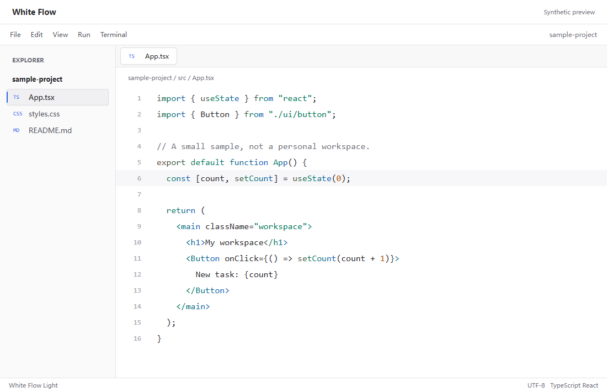

# White Flow

A white VS Code theme with an optional feature hub, opt-in editor effects, and optional workbench polish. Existing editor font settings are left alone.

**Status: experimental VSIX and source release, not a Marketplace release.** The color theme and the feature hub use the supported extension API. The optional workbench patch uses unsupported internals and is experimental. Read the [compatibility notes](docs/COMPATIBILITY.md) before installing it.

**Download:** [White Flow v0.2.0](https://github.com/wonderful66666/white-flow/releases/tag/v0.2.0), then choose `white-flow-vscode-0.2.0.vsix` under **Assets**. The automatic source archives are not extension installation packages.

**Unreleased 0.3.0 source:** adds the Keyword Flow switch, balanced syntax palette, read/write highlights, Focus Mode, Line Mist, Method Beams, Edit Trail, and Rust Risk Radar. The published v0.2.0 VSIX does not contain these additions. Patch-dependent features require both updated layers; older keyword patches remain always-on until restored and reapplied.



The preview uses fictional files and sample code, not a screenshot of a personal workspace. Open `demo/index.html` locally and use its Keyword Flow checkbox to try the animation. It is a visual demonstration with a synthetic signal producer, not a working editor or proof of desktop compatibility.

## Three Layers

| Layer | What it does | Installation |
| --- | --- | --- |
| Color theme | White editor, neutral identifiers and structure, purple keywords, blue functions, teal types, green strings, amber constants, and rose metadata | Standard VS Code theme |
| Feature hub | Opt-in typing, keyword flow, focus, mist, beams, edit-trail, and Rust-risk controls, all off by default | Same extension; enable features from the hub |
| Optional patch | Workbench polish, keyword flow, line mist, brushed-silver beams, and richer typing motion | Explicit local application-file modification; update with the extension |

While **White Flow Light** is selected, a sparkle button in the editor title bar opens the feature hub. The **White Flow: Open Feature Hub** command works with any theme. With every feature off, the extension only registers that command and a settings listener after startup.

The patch does not install React, Motion, Magic UI, or React Bits into VS Code. It is a small CSS/DOM adaptation inspired by those visual styles, not an official integration.

The 0.3.0 source palette reserves `#7C3AED` for keywords and `self`/`this`; Java type references, Rust lifetimes, macros, and bracket pairs do not share that flow color. Identifiers remain ink, punctuation and namespaces use a quieter gray, and comments use a separate gray. TextMate and semantic-token foregrounds are tested against white, the current-line highlight, and the blue selection; comments have a lower selection threshold. Bracket guides, inlay hints, diagnostics, diff highlights, Git markers, and sticky-scroll highlights have explicit colors without changing other workbench surfaces or fonts.

## Install The Released VSIX

1. Use desktop VS Code 1.98 or newer. Download the `.vsix` asset from the release above.
2. Open the Command Palette and run **Extensions: Install from VSIX...**, then select that file.
3. Reload VS Code if requested. Open it normally; an Extension Development Host is not required.
4. Run **White Flow: Open Feature Hub**, select the features you want, and press Enter to apply. Features are off by default.
5. Optionally select **White Flow Light** through **Preferences: Color Theme**. Installing the VSIX does not switch your theme or change your fonts.

The VSIX needs no Node.js, npm, Python, or Conda setup. It is a local unsigned package with the identifier `white-flow-local.white-flow-vscode`, not a verified Marketplace listing. Review the source and release checksum before installing.

**The VSIX alone does not apply the full skin.** It provides the theme, feature hub, and supported fade effect. Keyword color flow, workbench polish, and blur-and-rise typing require the separate optional application patch in this repository. See [the patch guide](docs/INSTALLATION.md#experimental-workbench-patch) before using it; it changes installed application resources, requires a private backup, and remains experimental.

If typing motion is enabled but nothing changes, check **Workbench: Reduce Motion**. `on` deliberately disables the effect. Change that preference only if you want motion; the extension never changes it automatically.

VSIX installations do not provide Marketplace auto-updates by default. Install a newer release asset manually when upgrading. See [Installation](docs/INSTALLATION.md) for checksums, removal, source builds, patch installation, and restoration.

## Build From Source

Node.js 22 or newer is needed only for source development and the optional patch tools. There are no runtime dependencies and no install hooks; TypeScript and type definitions are development dependencies only. The optional installer never downloads anything or elevates privileges automatically.

```sh
npm ci --ignore-scripts
npm run compile
node --test
node --check src/keyword-flow.js
node tools/audit-release.cjs
```

See the [Development Guide](docs/DEVELOPMENT.md) for technology choices and the rules every feature follows.

The installer does not read or write user settings, keybindings, interpreter paths, Conda environments, language toolchains, or font preferences. It modifies a workbench HTML entry and adds three owned appearance files beside it. This can trigger VS Code integrity warnings and may break after an update.

## Motion And Accessibility

### Read and write occurrences (theme only)

Reads of the symbol under the cursor have a translucent pale-gray background; writes have a translucent amber background and border. Plain text matches have a separate gray fallback and overview-ruler markers. The language provider decides read/write kinds; not every language reports the distinction. Existing symbol-highlighting preferences still apply. This is static theme data, with no extension listener, patch requirement, animation, or separate feature switch.

Tests composite both highlight backgrounds over white and the current-line highlight before checking syntax contrast: at least 4.5:1, or 4.0:1 for comments. Selections and third-party decoration combinations remain separate readability considerations.

### Focus Mode (supported API)

Enable **Focus Mode** to keep the innermost function, method, or constructor containing the cursor clear and dim surrounding lines. `whiteFlow.focusMode.opacity` defaults to `0.4` (range `0.25` to `0.7`). Missing symbols or a cursor between functions leaves the file undimmed. It uses document symbols rather than parsing source; providers can classify constructs differently. File/untitled documents up to 50,000 lines qualify. Per-version caching and stale-result checks protect edits and editor switches. This is static opacity, not motion. Dimming intentionally reduces surrounding contrast; disable it when that impairs reading.

### Line Mist (updated patch)

Enable **Line Mist** for a faint purple/blue/teal/rose band and optional cursor glow on the current line. `whiteFlow.lineMist.drift` and `cursorGlow` default true, but the feature itself defaults off. The signal requires the White Flow theme. Workbench Reduce Motion requests a static band; OS reduced motion also stops drift/transitions, and forced colors removes the mist. Without a compatible patch, the native line highlight remains unchanged.

One shared rule drifts at 50 pixels per second, updated at 6 Hz with 167 ms interpolation, pausing during typing, scrolling, hidden windows, and focus loss. Cursor writes are coalesced to at most six per second. Recreated rows have no entrance animation. Contrast tests cover each band stop plus the glow center over white with the 4.5/4.0 thresholds.

### Method Beams (supported fallback plus updated patch)

Enable **Method Beams** to connect a same-file call to its definition, or up to five nearest same-file callers when the cursor is on the definition. Call-hierarchy support must be provided by the configured language service. Missing providers, cross-file results, multiple selections, and recent typing show no beam; the feature does not parse source to infer calls.

Without the new renderer marker, a narrow silver gutter bracket is used. The updated patch plus White Flow theme adds a body-level brushed-silver SVG, a one-shot 420 ms glint, and a fade to 40% after two seconds. Reduced motion removes glints/fade transitions. Unsafe or off-screen endpoints use line-number chips; nonnumeric/relative gutters can suppress drawing. Visible suggest/hover/find/peek widgets hide the overlay.

### Edit Trail (supported API)

Enable **Edit Trail** for narrow purple gutter bars and overview-ruler marks. `whiteFlow.editTrail.minutes` defaults to 10 (range 2 to 60). Only rebased line numbers and timestamps are kept in memory, capped at 2,000 per document. Undo/redo count as edits; closing a document or disabling the feature forgets its trail. Three age buckets end at 20%, 50%, and 100%; the oldest bucket splits at 75% to provide four visual opacity levels.

**White Flow: Previous Edit** moves toward older marks, starting at the newest when the cursor is elsewhere; **Next Edit** moves toward newer marks. Navigation wraps. The shared glyph margin can have competing breakpoint/extension icons; narrow bars do not reserve a private lane. Redraws are debounced by 500 ms and aging runs every 30 seconds only while focused.

### Risk Radar (Rust, supported API)

Enable **Risk Radar (Rust)** for amber wavy underlines and English hints on `.unwrap()`, `.expect(`, panic-family macros, and `unsafe`. The lexical scanner is independent of rust-analyzer and skips comments, strings, raw/byte/char literals, and lifetimes. `whiteFlow.riskRadar.ignoreTests` defaults true for direct `#[cfg(test)]` modules and `#[test]` functions. It is not a compiler, macro expander, complete panic detector, or safety proof: shadowing, aliases, generated code, complex cfg attributes, and indirect panics are outside its scope. Files above 1 MiB are skipped; at most 5,000 findings are decorated. Findings use UTF-16 offsets; source text is never retained, logged, or uploaded.

### Typing motion (feature hub)

When enabled, a short insertion appears with a short effect, 140 ms by default. Only the newest insertion moves, and only vertically; horizontal text positions stay unchanged. Each edit settles the previous effect immediately. Multiline or long paste, Enter, indentation, undo, redo, ordinary ASCII replacements, and large multi-cursor edits do not animate. Change events do not identify the input source: short paste and some completion or input-method edits can also animate. With an input method, composition replacements usually stay still and a short committed non-ASCII word can animate.

- Without the patch: the character fades in through the supported decoration API.
- With the patch: the character blurs in and rises into place using keyframes from the patch stylesheet.

The extension learns about an edit slightly after the editor draws it, so the character can be visible for a frame or two before the effect starts. `workbench.reduceMotion: on` disables the effect. The API-only fade cannot detect OS motion preferences when that setting is `auto`; set it explicitly to `on` to disable motion. With the patch, OS reduced-motion and forced-color preferences also remove the rise keyframes.

### Keyword flow (extension switch plus updated patch)

In the 0.3.0 source, choose **Keyword Flow** in the feature hub and confirm with Enter. It is off by default. Set `whiteFlow.keywordFlow.palette` to `aurora` (purple, blue, teal, rose) or `spectrum` (red, green, blue, purple) through settings. The signal exists only with **White Flow Light** selected and Workbench Reduce Motion not set to `on`. The extension never changes the chosen theme or that preference automatically. A detected patch marker alone does not prove that an older installed runtime understands the new switch.

The new patch starts off and polls only stylesheet metadata about every 1500 ms while focused and visible; allow that delay plus a short refresh debounce after changing the switch. Turning it off removes the gradient stylesheet and stops color ticks. Disabling or uninstalling the extension also removes its signal; reload if VS Code requests it. The new patch then shows ordinary token colors.

Only the White Flow purple keyword color (`rgb(124, 58, 237)`) matches. Blue function-name classes and the previous broad blue/magenta matches are excluded. This remains color-class matching, not a parser or semantic keyword service; reusing the same purple in custom token overrides can broaden the match.

Both palettes use OKLCH interpolation when supported and a validated ordinary-gradient fallback otherwise. Unsupported gradients never leave transparent text behind. One shared CSS rule updates at six ticks per second, pausing during typing, scrolling, background use, or reduced motion. Selection and forced-color styles restore readable solid colors. See [Performance](docs/PERFORMANCE.md).

An old installed patch keeps its previous always-on behavior even if this extension is updated. Restore it using its own private state, reapply the new source patch with a fresh state directory, and reload; the installer deliberately refuses changed payloads in an active installation. See [upgrading both layers](docs/INSTALLATION.md#upgrade-keyword-flow-to-030).

## Project Layout

- `themes/`: supported color-theme data, with no font or machine configuration.
- `extension/`: TypeScript sources for the feature hub and features, compiled to `out/`.
- `src/`: optional workbench patch assets.
- `tools/`: explicit installer, restore command, and release audit.
- `test/`: synthetic installer and privacy fixtures.
- `demo/`: fictional public preview with no external resources.
- `docs/`: development, installation, compatibility, performance, and release guidance.

## Privacy And Licensing

No personal settings, local backups, credentials, author identity, server addresses, or real workspace screenshots belong in this repository. The audit uses an explicit release-file allowlist, but it cannot prove the absence of all sensitive information. Review images and future Git history manually. See [Privacy](docs/PRIVACY.md) and the [Release Checklist](docs/RELEASE_CHECKLIST.md).

Project code is offered under the [MIT License](LICENSE), with separate notices in [Third-Party Notices](THIRD_PARTY_NOTICES.md). No React Bits component source is redistributed. White Flow is not affiliated with Microsoft, shadcn/ui, Magic UI, or React Bits.
